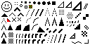
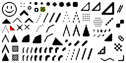

# xBR

A pixel art upscaler for Rust. It doubles the size of an image with the xBR x2 filter by Hyllian, which follows the edges in the artwork and smooths them, instead of turning every pixel into a blocky square.

| Input | Output |
| --- | --- |
|  |  |
|  |  |
|  |  |

## Features

- Straight edges stay sharp, while diagonal and shallow edges get smoothed.
- Transparency is supported, so sprites fade out at their edges without a dark fringe.
- No dependencies by default, it works on plain RGBA bytes.
- Optional loading and saving of image files through the `image` feature.

## Installation

```sh
cargo add xbr
```

To also load and save image files:

```sh
cargo add xbr --features image
```

## Usage

### RGBA bytes

`x2` takes a `Block` of RGBA bytes, 4 for each pixel, and returns a new `Block` twice as wide and twice as tall.

```rust
use xbr::{x2, Block};

// A 2x2 image of opaque red pixels.
let bytes = [255, 0, 0, 255].repeat(4);

let upscaled = x2(Block::new(bytes, 2, 2));

assert_eq!((upscaled.width, upscaled.height), (4, 4));
```

`x2` panics if the number of bytes doesn't match `width * height * 4`.

### Image files

With the `image` feature enabled:

```rust
use std::path::Path;

let block = xbr::image::from_path(Path::new("in.png"))?;
let upscaled = xbr::x2(block);
xbr::image::save(upscaled, Path::new("out.png"))?;
```

## Example

Upscales `examples/assets/input1.png` into `examples/assets/output1.png`:

```sh
cargo run --example process_image --features image --release
```

## Roadmap

- Add docs
- Add x3 and x4 versions
- Allow resizing: e.g. x2.7 uses x3 and scales down a little

## Resources

- [xBR algorithm tutorial](https://forums.libretro.com/t/xbr-algorithm-tutorial/123)

### Projects

- <https://github.com/mukaschultze/xBR-rs>
- <https://github.com/joseprio/xBRjs>
- <https://github.com/carlosascari/2xBR-Filter>

### Resizing

- <https://github.com/Cykooz/fast_image_resize>
- <https://github.com/irokaru/pixel-scaler/blob/master/src/lib/FileUtil.js#L100>

## License

MIT, see [LICENSE-MIT](LICENSE-MIT).
